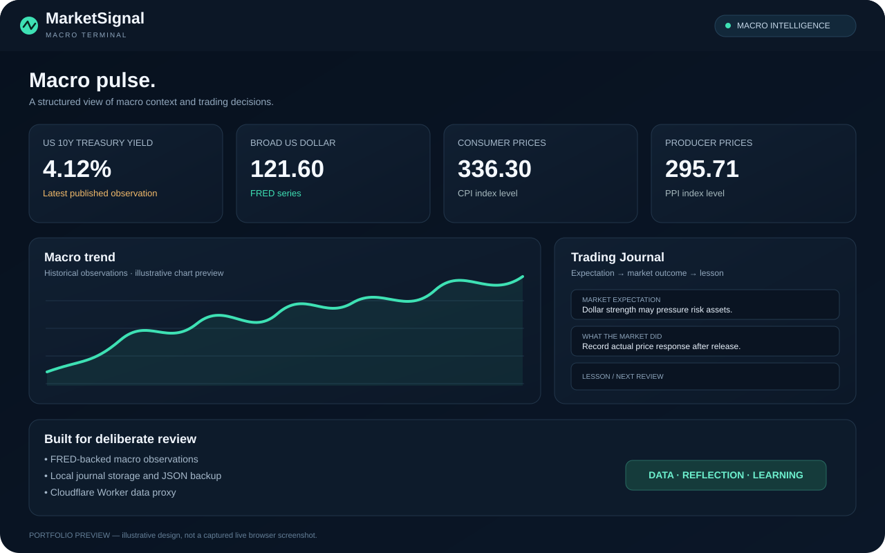

# MarketPilot AI — Market Research Workspace

**Live demo:** https://joeybuilds043.github.io/Learner-journal/  
**AI backend source:** [backend/](./backend/) · CrewAI + FastAPI  
**Source code:** https://github.com/Joeybuilds043/Learner-journal

## Dashboard preview

*Illustrative portfolio preview, not a captured screenshot of the live page. Macro values and chart are illustrative; use the live app for current source data.*

## What it does

MarketPilot AI is a mobile-first market research workspace. It combines published US macroeconomic observations, public crypto market data, a CrewAI-based AI analyst service scaffold, daily research, and the original local trading journal.

- **Macro dashboard:** latest available US 10-year Treasury yield, broad US dollar index, CPI, PPI and VIX observations from FRED through a Cloudflare Worker.
- **Historical data:** requests series observations from the Worker when history is available.
- **Manual values:** records clearly labelled local overrides without replacing the official source data.
- **Trading journal:** record macro context, expectation, market outcome and lesson. The original localStorage key is unchanged.
- **AI Analyst workspace:** illustrated fictional veteran-investor avatar, follow-up prompt suggestions, live-context analysis UI, and a Python CrewAI backend scaffold.
- **Daily Research:** current Binance spot ticker snapshots for BTC, ETH, SOL, BNB and XRP, plus a report-generation UI.
- **Profile workspace:** local preferences now; real sign-in is intentionally not faked and requires identity-provider setup.
- **Backend scaffold:** FastAPI + CrewAI + Gemini API, server-side data retrieval, basic rate limiting, and a SQL schema draft.
- **Search and backup:** search saved reviews, delete entries, export JSON and import a previous backup.
- **Progressive Web App:** manifest and service worker support installation and caching of core app files.

## How the code works

### 1. HTML — index.html

HTML defines the page structure: the MarketSignal heading, dashboard and journal sections, form fields, buttons, and containers where data appears. It also loads macro-dashboard.js. Think of HTML as the skeleton of the app.

### 2. CSS — styles inside index.html

CSS controls layout, spacing, typography, colors, panels and responsive behavior. The dashboard uses a dark, mobile-first visual style. CSS changes presentation; it does not fetch economic data or save journal entries by itself.

### 3. JavaScript and fetch() — macro-dashboard.js

JavaScript adds behavior. The dashboard uses fetch() to send HTTP requests to the Cloudflare Worker endpoint configured in the API_URL constant. For historical data it requests the Worker's history route with a series identifier. The response is JSON, which the code parses and uses to update dashboard cards and charts. If a request fails, the interface should report that the data could not be loaded rather than treating missing data as a real zero.

### 4. API response

An API is a defined way for one program to request data from another. FRED provides published economic time series; the Worker acts as a controlled middle layer. The browser expects structured JSON, not a whole HTML webpage. Published macro series can have release delays and are not tick-by-tick trading prices. The broad US dollar series used here is not the ICE DXY index.

### 5. localStorage

Browser localStorage stores the journal and manual overrides on the current device/browser. This is why saved entries can remain after a refresh without a user account. It also means entries do not automatically sync to another phone or computer. Export a backup before clearing site data or changing devices.

### 6. Cloudflare Worker — server-side data proxy

The Worker at https://marketsignal-data.joeybuilds043.workers.dev/ receives requests from the frontend and calls FRED. The FRED_API_KEY is configured as a server-side secret, not embedded in frontend JavaScript. The Worker is also connected to Cloudflare D1 for stored historical observations. Never commit API keys or secret values to GitHub.

### 7. GitHub Actions and GitHub Pages

GitHub stores the source code and commit history. The workflow in .github/workflows/deploy.yml packages the static website and deploys it to GitHub Pages when changes reach main. The public Pages URL serves the files to visitors. A successful workflow run confirms the deployment job completed; it does not, by itself, prove every API card or interaction has passed a live browser test.

## Technology

HTML · CSS · Vanilla JavaScript · PWA · Cloudflare Workers · Cloudflare D1 · FRED API · Python · FastAPI · CrewAI · Gemini API · SQL schema · GitHub Actions · GitHub Pages

## Run locally

Because this is a static web app, the front end can be served from a local static HTTP server or hosted on GitHub Pages. The macro dashboard uses the deployed Cloudflare Worker endpoint configured in macro-dashboard.js; a working data connection requires the Worker secret FRED_API_KEY to be configured server-side.

## Data and privacy

FRED indicators are published economic observations, not tick-by-tick prices. Journal entries and manual overrides are stored locally in the current browser and do not automatically sync to another device. Export a backup before clearing browser site data.

MarketSignal is a learning and analysis tool, not an automated trading system or financial advice.

## MarketPilot AI phase 1 status

The four main navigation options are **Markets, Journal, AI Analyst, and Profile**. Daily Research is nested inside AI Analyst so the main navigation stays focused. Public Binance market snapshots and the FRED macro dashboard are independent of the AI service.

The AI backend is scaffolded in `backend/`, but it is **not deployed yet**. Until the service is deployed and `marketpilot-config.js` contains its public base URL, AI answers and generated daily briefs will report that the service is not configured. Add `GEMINI_API_KEY` only to the backend host's secret/environment settings. The Gemini free tier has rate limits; no unlimited free AI API is promised. Binance public market-data endpoints also have rate limits and regional availability can vary.

The Profile view currently saves preferences locally; it is not authentication. A secure login and account-linked SQL storage require an identity/database provider to be configured. The supplied `backend/schema.sql` is a schema draft, not an active migration. Existing journal data remains in the browser under `learner-journal-entries-v1`; do not clear site storage during this phase.

### Backend development

See [backend/README.md](./backend/README.md). CrewAI is Python-based, so the AI orchestration runs in Python. SQL is used for the planned persistent data layer. C++ and Java are not added just to increase the number of languages; they would add deployment complexity without solving a requirement in this stack.
